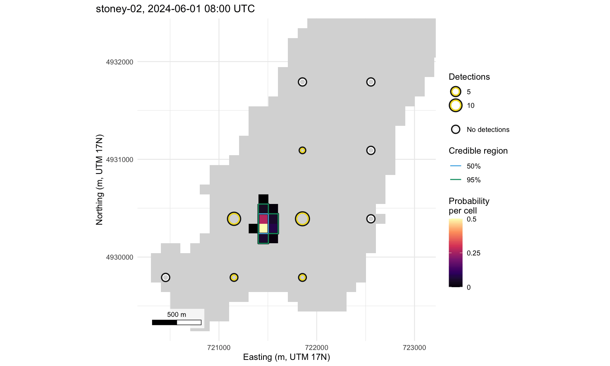

<!-- README.md is knitted from README.Rmd; edit README.Rmd. -->

# detfield 

[-blue.svg)](https://www.gnu.org/licenses/gpl-3.0)

**detfield** turns the detections of a fixed acoustic receiver array
into hourly location surfaces: for each tagged animal and hour, the
probability that the animal was in each water cell. It takes a range
model you fitted, a depth raster of the water body, the receiver
deployments, the detections and the tag delays, in the column names the
positionR packages share. Each hour is estimated on its own, with no
movement model ([the
model](https://jakebrownscombe.github.io/detfield/articles/positioning.html#the-model)).

## Install

``` r
# install.packages("remotes")
remotes::install_github("jakebrownscombe/detfield")
```

The articles are on the [package
website](https://jakebrownscombe.github.io/detfield/). One of them,
[Position fish from a cleaned detection
set](https://jakebrownscombe.github.io/detfield/articles/from-detqc.html),
also needs the [**detqc**](https://jakebrownscombe.github.io/detqc/) R
package.

To install all four positionR packages at once, see the
[**positionR**](https://jakebrownscombe.github.io/positionR/) landing
page.

## Example

The Stoney Lake example has 70 receivers and a range model. One
simulated animal is positioned here from one hour of its detections.

``` r
# Attach detfield and build the Stoney Lake field from the example's curve
library(detfield)
lake <- terra::rast(system.file("extdata", "stoney_depth.tif",
                                package = "detfield"))
curve <- de_logistic(d50 = c(250, 750), d05 = c(500, 1500), depth = c(1, 35))
field <- de_field(water_distances(lake, stoney_track$receivers),
                  de_model(curve, sigma = list(station_hour = 0)))
#> 194 of 7,669 receiver-cell pairs with p >= 0.05 have land on the
#>   straight line between them; with blocked = 0 the curve is read on
#>   them as if the line were clear. See `blocked` in ?de_model.
# Position stoney-02 from its detections between 08:00 and 09:00 UTC
dets <- subset(stoney_track$detections, animal_id == "stoney-02" &
                 format(datetime, "%d %H", tz = "UTC") == "01 08")
counts <- bin_detections(dets, stoney_track$receivers, stoney_track$tags)
surface <- location_surface(counts, field)
plot(surface)
```



*Location surface of `stoney-02` for 08:00 to 09:00 UTC on 1 June 2024,
from its 29 detections at 5 receivers, on 100 m water cells.*

The 95% credible region of the hour holds 6 water cells.

## Articles

- [Fish positioning with detection range
  information](https://jakebrownscombe.github.io/detfield/articles/detfield.html),
  the Get started page: a range test counted and fitted, the field
  built, and five animals positioned by the hour.
- [Range models: bring your own, or start from two
  distances](https://jakebrownscombe.github.io/detfield/articles/range-model.html)
  reads a model that varies with depth and date into a field for each
  day.
- [Hourly positions against the true
  track](https://jakebrownscombe.github.io/detfield/articles/positioning.html)
  scores the hourly positions, regions and use map against simulated
  tracks.
- [Habitat selection: depth use from hourly
  positions](https://jakebrownscombe.github.io/detfield/articles/habitat-selection.html)
  measures how far the depth of position draws falls from the true
  depth, and what that does to a use-availability coefficient, for
  animals with a known preference.
- [Position fish from a cleaned detection
  set](https://jakebrownscombe.github.io/detfield/articles/from-detqc.html):
  a detection set cleaned by the
  [**detqc**](https://jakebrownscombe.github.io/detqc/) R package handed
  to **detfield**.

## The suite

**detfield** is one of the four positionR packages, which share one set
of column names, one range model and one lake for their examples, Stoney
Lake.


- [positionR, the suite](https://jakebrownscombe.github.io/positionR/)
- [**detqc**](https://jakebrownscombe.github.io/detqc/): read, check and
  filter detections.
- [**detfield**](https://jakebrownscombe.github.io/detfield/): detection
  fields and positions.
- [**arraydesign**](https://jakebrownscombe.github.io/arraydesign/):
  design and test the performance of tracking systems.
- [**arraydesignR**](https://jakebrownscombe.github.io/arraydesignR/):
  **arraydesign** as a point-and-click application.

**detqc** exports the same five figure functions as **detfield**. The
copies are identical, so the masking message R prints when both packages
are attached can be ignored. Every map in the suite draws a receiver in
the three ring colours:

``` r
positionr_ring_colours()
#>     heard    silent      edge 
#> "#FDE725" "#FFFFFF" "#1A1A1A"
```

## Cite

Brownscombe JW (2026). *positionR: tools for acoustic telemetry
studies*. R package version 2.0.0,
<https://jakebrownscombe.github.io/positionR/>.

Brownscombe JW (2026). *detfield: Detection Fields and Location Surfaces
for Acoustic Telemetry*. R package version 0.1.1,
<https://jakebrownscombe.github.io/detfield/>.

## How the code was written

The code and this documentation were written with an AI coding
assistant, Claude Code v2.1.145.

## Licence

GPL (\>= 3).
